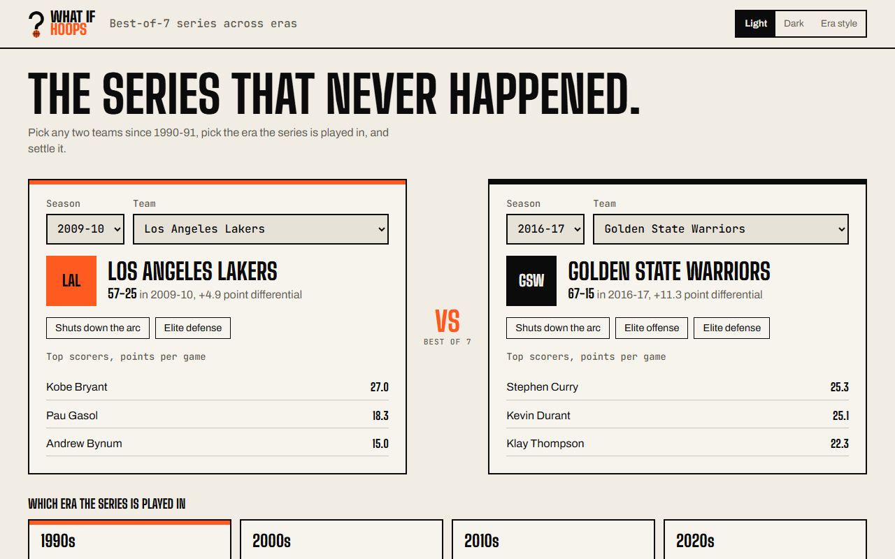
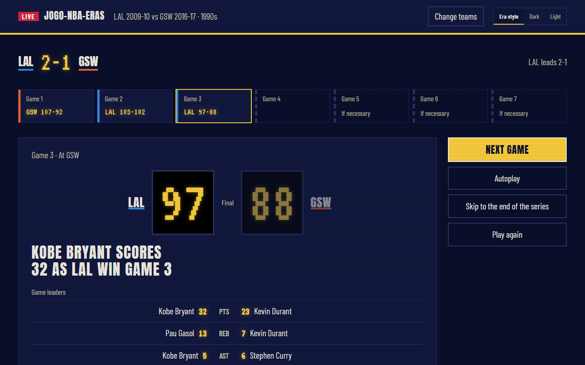
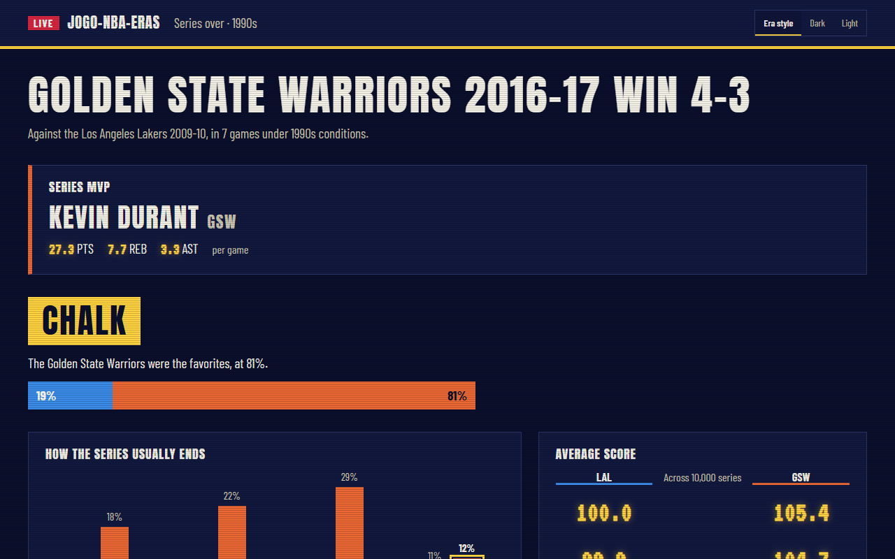
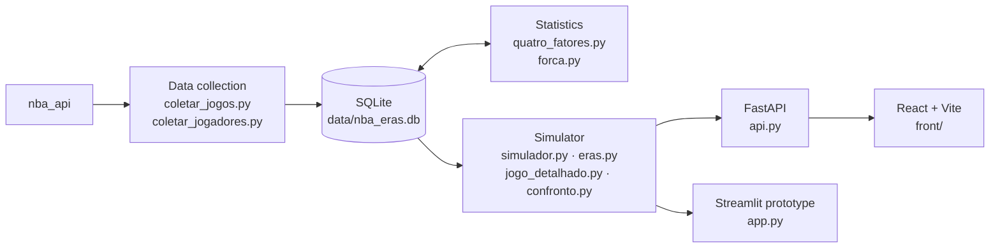

# jogo-nba-eras

[](https://github.com/jpgomespnd/jogo-nba-eras/actions/workflows/ci.yml)
[](LICENSE)

**English** | [Português](README.pt-BR.md)

A best-of-7 series simulator between NBA teams from different seasons (1990-91 onward), played under the conditions of an era you pick: the 2009-10 Lakers vs the 2016-17 Warriors in the 1990s, for example.

| Validation | Result |
|---|---|
| Real playoff series (1990-91 to 2025-26), predicted from regular-season data only | **75.7% correct** over 540 series (the team with home court wins 73.9%) |
| Calibration of the odds | **Brier score 0.167** (a coin flip scores 0.250) |
| Simulated vs real player production per 36 minutes | correlation of **0.93 to 0.96** |



| The series, game by game | The odds, revealed at the end |
|---|---|
|  |  |

## Architecture



The code and comments are in Portuguese; the website is in English.

## How it works

1. **Data collection** (`coletar_jogos.py`, `coletar_jogadores.py`): team and player box scores for every regular-season and playoff game, via [`nba_api`](https://github.com/swar/nba_api).
2. **Four factors** (`quatro_fatores.py`): pace, efficiency and Dean Oliver's four factors (eFG%, turnovers, offensive rebounding, free throws) for every team-season, on offense and defense, stored as the league average plus each team's deviation from it; home-court advantage for each season.
3. **Effective strength** (`forca.py`): schedule-adjusted point differential, differential against good teams, win percentage and series won in the two previous seasons, weighted by a regression on playoff games. Whatever the four factors miss enters the simulator as a bonus, together with fatigue.
4. **Simulator** (`simulador.py`): possession-by-possession Monte Carlo, vectorized with numpy. Each possession probability is the era average + the offense's deviation + the opposing defense's deviation. A team that builds a bigger lead than expected eases off, which makes the spread of scores match real games (~13 points).
5. **Eras** (`eras.py`, `confronto.py`): the average environment of each decade. A team carries its relative standing (z-score) into the new era, which predicted real changes in the league better than keeping the absolute difference.
6. **Players** (`elenco.py`, `jogo_detalhado.py`): each team's "healthy" rotation and a possession-by-possession game with the same probabilities as the simulator, deciding who made each play: box score, game clock, play-by-play and foul-outs. Minutes follow real playoff rotations.
7. **API** (`api.py`, FastAPI) and **front end** (`front/`, React + Vite): pick the teams, the era and home court; watch the series game by game, with a play-by-play finish in close games; see the odds only when it's over. The site is called **What If Hoops**, in light and dark versions of its own identity (bone, ink and basketball orange), with an option to dress the interface up as the chosen era instead.

| Endpoint | Returns |
|---|---|
| `GET /temporadas` | The 36 seasons |
| `GET /times?temporada=2016-17` | Teams of a season: record, differential, strength, style tags and top scorers |
| `GET /eras` | Eras with description, pace, three-point volume and points per shot |
| `POST /serie` | A series game by game: scores, box scores, plays, headlines, leaders, standout performances and the series MVP (no odds) |
| `POST /revelar` | Each team's odds, the 4-0 to 4-3 distribution and each team's style in the era |

## Running it

```powershell
py -3.12 -m venv .venv
.venv\Scripts\python -m pip install -r requirements.txt
cd scripts
..\.venv\Scripts\python coletar_jogos.py
..\.venv\Scripts\python coletar_jogadores.py
..\.venv\Scripts\python quatro_fatores.py
..\.venv\Scripts\python forca.py
cd ..
.venv\Scripts\uvicorn --app-dir scripts api:app --reload
```

Data collection takes about 15 minutes. Interactive API docs at http://localhost:8000/docs.

Front end (Node.js 20 or newer), with the API running, in another terminal:

```powershell
cd front
npm install
npm run dev
```

Opens at http://localhost:5173. Set `VITE_API_URL` to point it at another API. Streamlit prototype: `.venv\Scripts\streamlit run scripts\app.py`.

On Windows, keep the project in a short path (e.g. `C:\projects\jogo-nba-eras`): Streamlit ships files with long names and installation fails if the full path exceeds 260 characters, unless long path support is enabled.

## Tests and CI

```powershell
.venv\Scripts\python -m pytest tests
```

- `tests/test_simulador.py`: simulator properties on fabricated data, no database needed: a team against itself wins ~50%, the order of the teams doesn't matter, home court helps, the box score adds up to the final score, a series ends at 4 wins, translating a team to its own season changes nothing.
- `tests/test_api.py` and `tests/test_eras_banco.py`: the API and era consistency with real teams. They need the database and are skipped without it.

[GitHub Actions](.github/workflows/ci.yml) runs on every push and pull request: tests, front-end lint and build, and `pip-audit` and `npm audit` for known vulnerabilities. The database (~140 MB) is not on GitHub, so only the tests that don't depend on it run there. Dependabot proposes updates for pip, npm and GitHub Actions.

Full validations, with the database: `validar_playoffs.py`, `validar_jogadores.py`, `conferir_jogadores.py` and `testes_eras.py` (which also lists the 10 strongest teams in each era). From the command line: `confronto.py 2009-10 LAL 2016-17 GSW "anos 90"`.

## Data

`data/nba_eras.db` (SQLite, not in Git; schema in `sql/schema.sql`):

- `games`, `team_games`: team box score for every game.
- `player_games`: player box scores (~930k rows). From 1990-91 to 1995-96 a few players are missing in ~4% of games (under 1% of points) and there is no +/-.
- `vw_confrontos`: each team in a game with the opponent's stats alongside.
- `fatores_time`, `liga`: four factors per team-season (`liga_*` = league average, `rel_*` = deviation) and season averages, including home-court advantage.
- `forca_time`, `pesos_forca`: effective strength and bonus per team; weights for strength, playoff home court and fatigue.

## Limitations

It doesn't model injuries (on purpose: it's each team at its best), coaching adjustments or individual playoff experience. Team strength comes from team numbers; players only decide who made each play.

Unofficial project, not affiliated with the NBA. [MIT](LICENSE) license.
