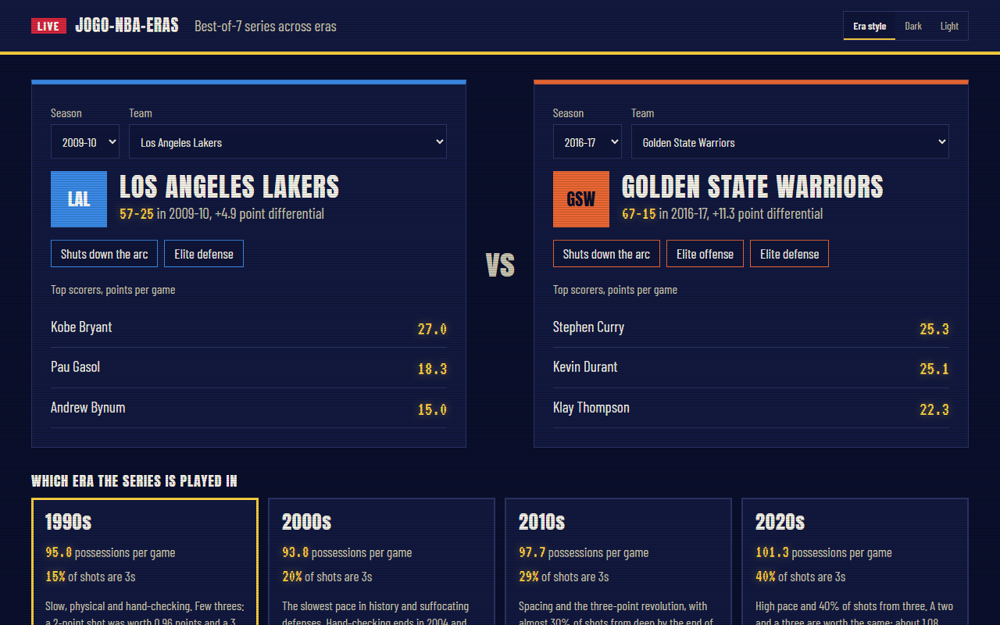
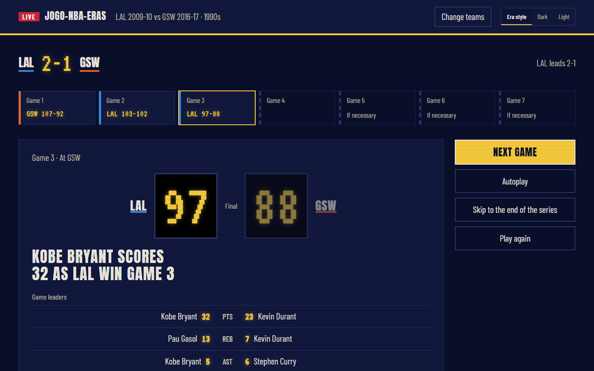
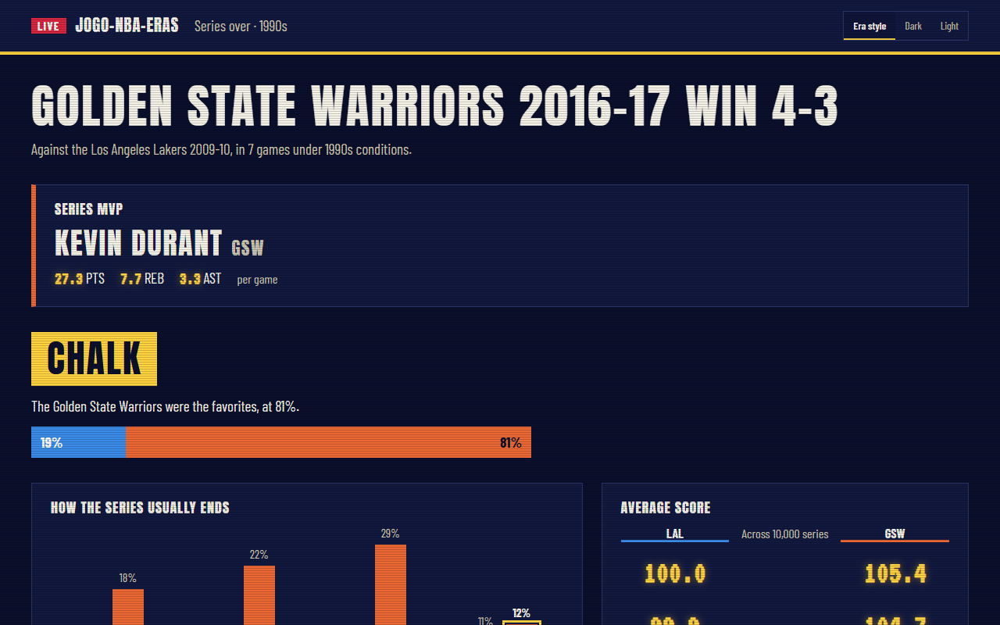
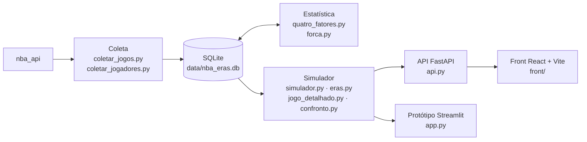

# jogo-nba-eras

[](https://github.com/jpgomespnd/jogo-nba-eras/actions/workflows/ci.yml)
[](LICENSE)

[English](README.md) | **Português**

Simulador de séries melhor de 7 entre times de temporadas diferentes da NBA (1990-91 em diante), jogadas no ambiente de uma era escolhida: Lakers 2009-10 x Warriors 2016-17 nos anos 90, por exemplo.

| Validação | Resultado |
|---|---|
| Séries de playoff reais (1990-91 a 2025-26), previstas só com a temporada regular | **75,7% de acerto** em 540 séries (o time com mando vence 73,9%) |
| Calibração das chances | **Brier 0,167** (chutar 50% dá 0,250) |
| Produção dos jogadores por 36 min, simulada x real | correlação de **0,93 a 0,96** |



| A série jogo a jogo | A revelação das chances no fim |
|---|---|
|  |  |

## Arquitetura



## Como funciona

1. **Coleta** (`coletar_jogos.py`, `coletar_jogadores.py`): box score de cada time e de cada jogador em cada jogo, temporada regular e playoffs, via [`nba_api`](https://github.com/swar/nba_api).
2. **Quatro fatores** (`quatro_fatores.py`): ritmo, eficiência e os quatro fatores de Dean Oliver (eFG%, desperdícios, rebote ofensivo, lances livres) de cada time-temporada, no ataque e na defesa, com a média da liga e o desvio de cada time; vantagem de mando de cada temporada.
3. **Força efetiva** (`forca.py`): saldo ajustado pelos adversários, saldo contra times bons, aproveitamento e séries vencidas nas duas temporadas anteriores, com pesos aprendidos numa regressão dos jogos de playoff. O que os quatro fatores não captam entra no simulador como bônus, junto com o desgaste.
4. **Simulador** (`simulador.py`): Monte Carlo posse a posse, vetorizado com numpy. Cada probabilidade da posse é a média da era + o desvio do ataque + o desvio da defesa adversária. Quem abre vantagem além do esperado relaxa, o que deixa o espalhamento dos placares igual ao real (~13 pontos).
5. **Eras** (`eras.py`, `confronto.py`): ambiente médio de cada década. O time leva para a outra era a sua posição relativa entre os times (escore z), que previu melhor as mudanças reais de ambiente do que manter a diferença absoluta.
6. **Jogadores** (`elenco.py`, `jogo_detalhado.py`): rotação "saudável" de cada time e um jogo posse a posse com as mesmas probabilidades do simulador, decidindo quem fez cada lance: box score, relógio, narração e eliminações por faltas. Os minutos seguem os playoffs reais.
7. **API** (`api.py`, FastAPI) e **front** (`front/`, React + Vite): escolha dos times, da era e do mando; a série jogo a jogo, com final narrado lance a lance; e a revelação das chances no fim. A interface veste a era escolhida. O site é em inglês; código e comentários, em português.

| Endereço | O que devolve |
|---|---|
| `GET /temporadas` | As 36 temporadas |
| `GET /times?temporada=2016-17` | Times da temporada: campanha, saldo, força, selos de estilo e cestinhas |
| `GET /eras` | As eras com descrição, ritmo, volume de 3 e pontos por arremesso |
| `POST /serie` | Uma série jogo a jogo: placares, box scores, lances, manchetes, líderes, destaques e o MVP da série (sem as chances) |
| `POST /revelar` | Chances de cada time, distribuição de 4-0 a 4-3 e o estilo de cada um na era |

## Como rodar

```powershell
py -3.12 -m venv .venv
.venv\Scripts\python -m pip install -r requirements.txt
cd scripts
..\.venv\Scripts\python coletar_jogos.py
..\.venv\Scripts\python coletar_jogadores.py
..\.venv\Scripts\python quatro_fatores.py
..\.venv\Scripts\python forca.py
cd ..
.venv\Scripts\uvicorn --app-dir scripts api:app --reload
```

A coleta leva cerca de 15 minutos. Documentação interativa da API em http://localhost:8000/docs.

Front (Node.js 20 ou mais novo), com a API ligada, em outro terminal:

```powershell
cd front
npm install
npm run dev
```

Abre em http://localhost:5173. Para apontar para outra API, defina `VITE_API_URL`. O protótipo em Streamlit: `.venv\Scripts\streamlit run scripts\app.py`.

No Windows, deixe o projeto num caminho curto (ex.: `C:\projetos\jogo-nba-eras`): o Streamlit tem arquivos internos com nomes longos e a instalação falha se o caminho completo passar de 260 caracteres, a menos que o suporte a caminhos longos esteja ativado.

## Testes e CI

```powershell
.venv\Scripts\python -m pytest tests
```

- `tests/test_simulador.py`: propriedades do simulador com dados fabricados, sem precisar do banco: um time contra ele mesmo dá ~50%, a ordem dos times não importa, o mando ajuda, o box score soma o placar, a série acaba com 4 vitórias, traduzir um time para a própria temporada não muda nada.
- `tests/test_api.py` e `tests/test_eras_banco.py`: API e coerência das eras com os times reais. Precisam do banco e são pulados sem ele.

O [GitHub Actions](.github/workflows/ci.yml) roda a cada push e pull request: testes, lint e build do front, e `pip-audit` e `npm audit` contra vulnerabilidades conhecidas. O banco (~140 MB) não vai para o GitHub, então lá rodam só os testes que não dependem dele. O Dependabot propõe atualizações de pip, npm e GitHub Actions.

Validações completas, com o banco: `validar_playoffs.py`, `validar_jogadores.py`, `conferir_jogadores.py` e `testes_eras.py` (que também mostra os 10 mais fortes em cada era). Pela linha de comando: `confronto.py 2009-10 LAL 2016-17 GSW "anos 90"`.

## Dados

`data/nba_eras.db` (SQLite, fora do Git; esquema em `sql/schema.sql`):

- `games`, `team_games`: box score de time de cada jogo.
- `player_games`: box score de cada jogador (~930 mil linhas). Entre 1990-91 e 1995-96 faltam alguns jogadores em ~4% dos jogos (menos de 1% dos pontos) e não existe +/-.
- `vw_confrontos`: cada time num jogo com as estatísticas do adversário ao lado.
- `fatores_time`, `liga`: quatro fatores por time-temporada (`liga_*` = média da liga, `rel_*` = desvio) e médias de cada temporada, com a vantagem de mando.
- `forca_time`, `pesos_forca`: força efetiva e bônus de cada time; pesos da força, do mando nos playoffs e do desgaste.

## Limitações

Não capta lesões (de propósito: é a melhor versão de cada time), ajustes de técnico nem experiência individual em playoffs. A força do time vem dos números do time; os jogadores só decidem quem fez cada lance.

Projeto não oficial, sem vínculo com a NBA. Licença [MIT](LICENSE).
